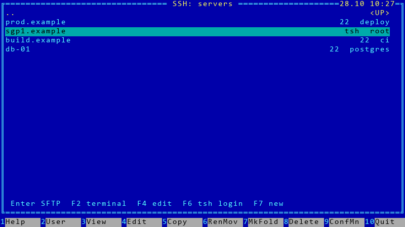
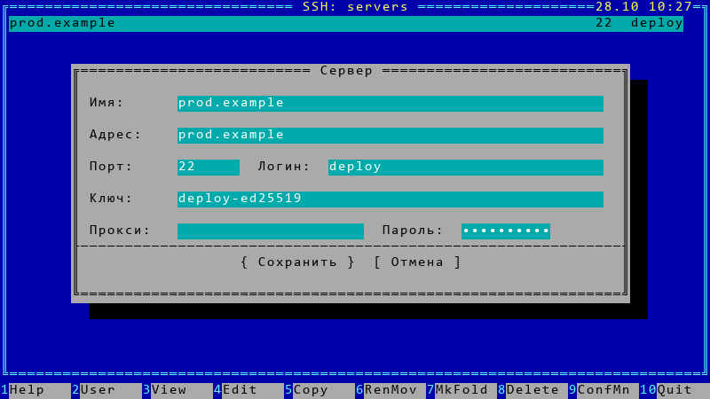
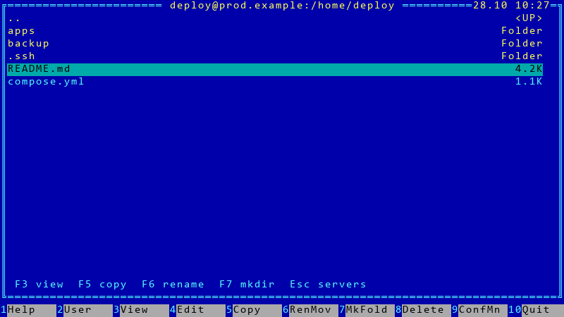
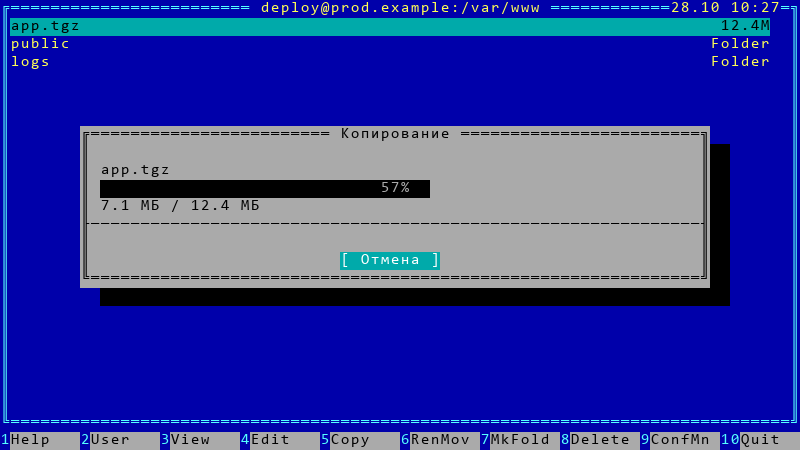
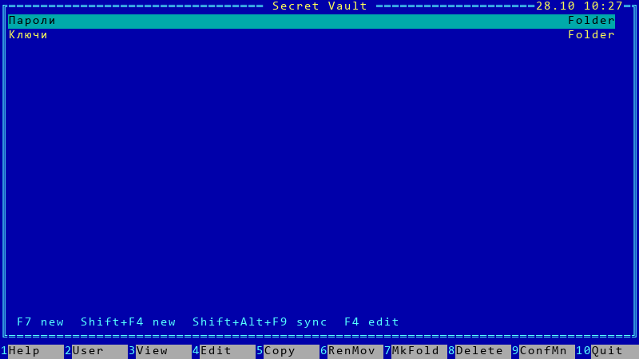
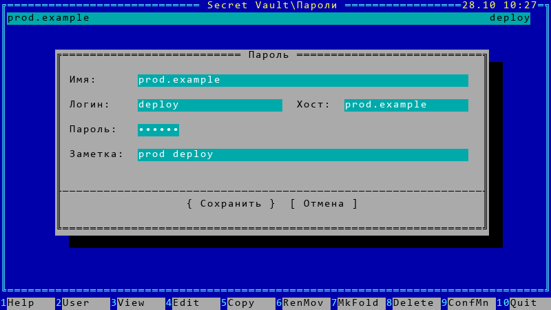
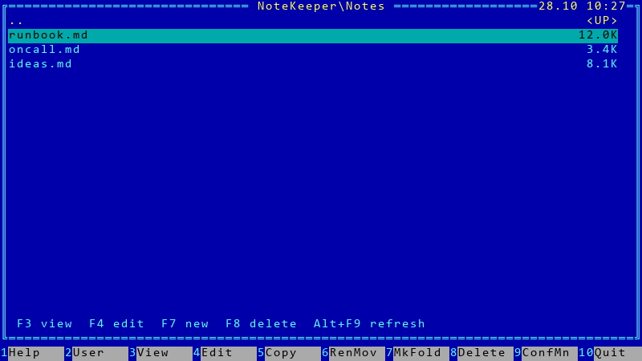
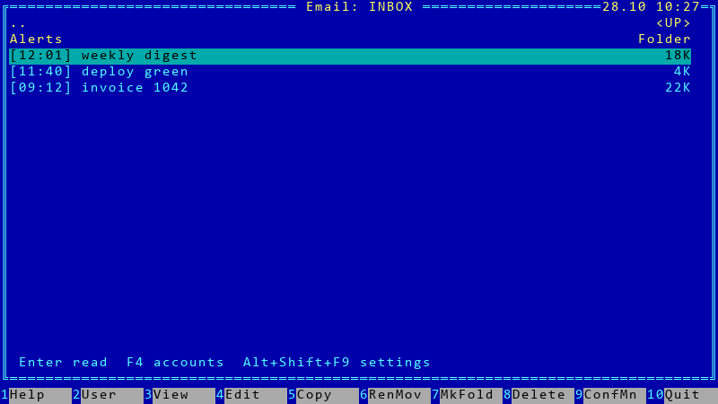
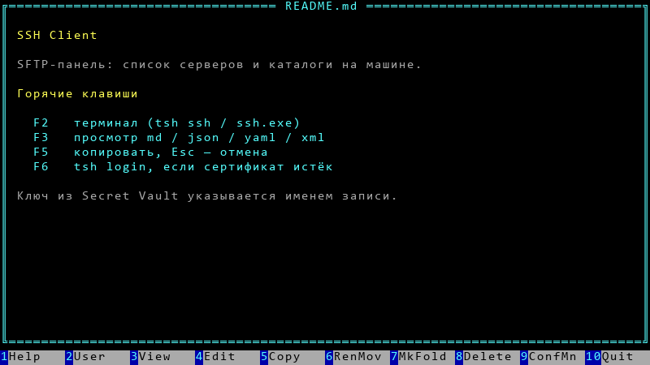

# Руководство пользователя

Плагины ставятся в `C:\Program Files\Far Manager\Plugins\<Name>`. Перед копированием DLL закрой FAR и запусти `install-plugin.bat <Name>` или `install-all.bat`.

Цифры дисков (`Alt+F1` / `Alt+F2`) плагины прописывают сами, если слот ещё пустой: Email `5`, SSH `6`, Vault `7`, NoteKeeper `8`.

Кадры ниже нарисованы в том же формате, что живые диалоги (ширина 63, подпись слева, поле с колонки 12, внизу `{ Сохранить } [ Отмена ]`). Это схемы, не скрины с твоей машины.

Перерисовать картинки:

```bat
python docs\tools\far_shots.py
```

---

## SSH Client

Диск `6` или `F11` → SSH, либо команда `ssh:`.



На списке:

| Клавиша | Действие |
| --- | --- |
| Enter | SFTP |
| F2 / Shift+Enter | терминал: `tsh ssh` для Teleport, иначе `ssh.exe` |
| F3 | карточка хоста |
| F4 | правка. У Teleport имя/адрес/порт только смотреть |
| F6 | `tsh login --mfa-mode=otp` в отдельном окне |
| F7 / Shift+F4 | новый сервер |
| F8 | удалить |

Поле **Ключ** — путь к PEM или **имя записи** Secret Vault. Для обычного (не Teleport) хоста этот ключ единственный: агент и `~/.ssh` не подмешиваются. **Пароль** тоже может быть именем из vault. Пустые поля ищут запись по точному хосту.



SFTP — `ssh.exe`. С ключом из vault: `-i` + `IdentitiesOnly=yes` + `IdentityAgent=none`, конфиг `~/.ssh` не читается. Без ключа в карточке — агент и `~/.ssh/config`, как в консоли. Teleport: `ssh.exe` + `tsh proxy ssh` и сертификат `~/.tsh`. Если `tsh login` протух — F6, не Enter.



В каталоге: `F3` открывает Markdown / JSON / YAML / XML локальным просмотрщиком, `F5` копирует, `F6` переименовывает, `F7` создаёт папку, `Esc` возвращает к списку серверов.



Полоса живёт в окне FAR, не только на кнопке панели задач. `Esc` или **Отмена** рвут передачу; недокачанный локальный файл удаляется.

---

## Secret Vault

Диск `7` или `F11` → Secret Vault. Файл `%APPDATA%\Far Manager\SecretVault\vault.bin` шифруется DPAPI текущей учётки.



`Пароли` и `Ключи`. `F7` / `Shift+F4` — новая запись (на корне тип зависит от строки под курсором). В каталоге: `F4` правка, `F5` / `Ctrl+C` секрет в буфер на 30 секунд, `F3` логин или публичный ключ, `F8` удалить.

Ключ с диска: встань на `id_ed25519` / `id_rsa` в другой панели и `F5` в `Ключи`.



`Shift+Alt+F9` — синк с NoteKeeper (`Alt+F9` по-прежнему размер окна FAR). URL только HTTPS. PAT лежит в DPAPI (`NoteKeeper\settings.ini`). Более новая локальная revision не затирается. Экспорт `Alt+F5`, импорт `Alt+F6` — AES-256-GCM с паролем.

SSH читает vault через `Plugin.SyncCall` (только SSH Client). Если плагин молчит — тот же URL+PAT и REST `/api/v1/vault`.

---

## NoteKeeper

Диск `8`, `F11`, либо `nk:`. Нужны scopes `notes` и `todos` (для vault ещё `vault`).



`Notes` и `Todos`. `F3` просмотр, `F4` правка Markdown в редакторе FAR (пишет обратно по REST), `F7` / `Shift+F4` создать, `F8` удалить, `Alt+F9` обновить. У todo: `F5` / Space — toggle, в карточке повтор и каналы Telegram / DingTalk. С другой панели `F5` принимает только `.md` и `.txt`.

PAT — DPAPI. `http://` только для localhost.

---

## Email Viewer

Диск `5`, `F11`, либо `email:`. IMAP с SSL (порт 993) или без (143).



`Alt+Shift+F9` — учётные записи: `F4` изменить, `Shift+F4` добавить. Host, порт, логин, пароль, SSL. Пароли этого плагина пока в открытом `%APPDATA%\Far Manager\EmailViewer.ini`.

---

## Просмотрщики

`F3` на обычной панели (и на SSH после скачивания файла):

- Markdown: `.md`, `.markdown`, …
- Pretty: `.json`, `.yaml`, `.yml`, `.xml`
- HTML: `.html`, `.htm`, `.xhtml`



В просмотре: `F8` / `Shift+F8` тема (общая палитра на 16 цветов), `F7` поиск, `Esc` выход. Pretty ещё `F2` — сырой текст.

---

## Установка

Готовая сборка: [Releases](https://github.com/darvik80/far-manager-plugins/releases) → `install.bat`.

Из исходников: `build.bat`, затем с закрытым FAR `install-all.bat`.
