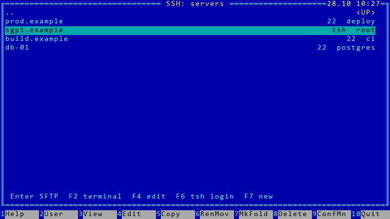
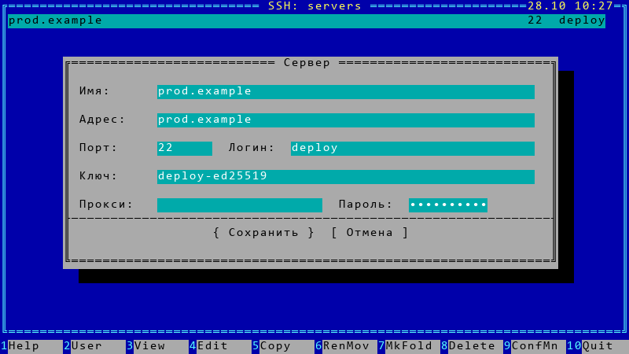
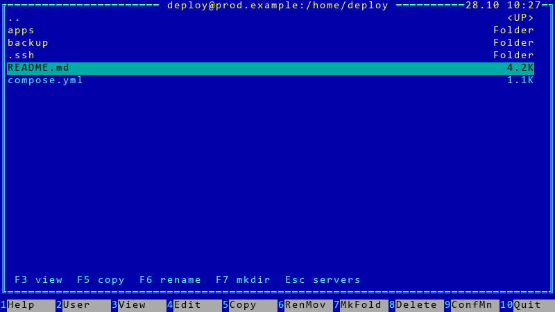
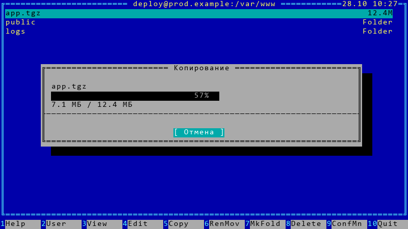
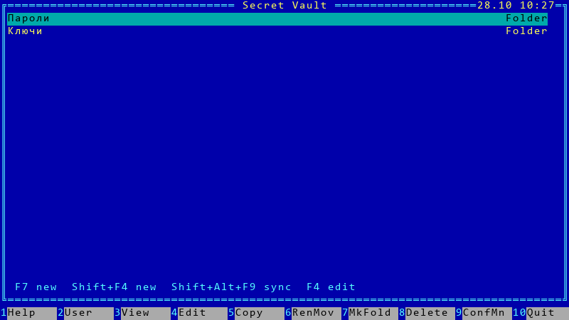
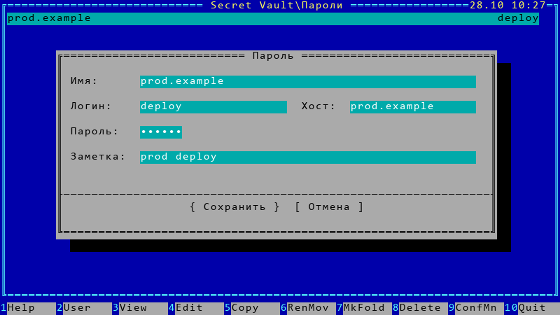
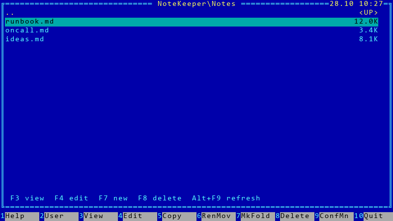
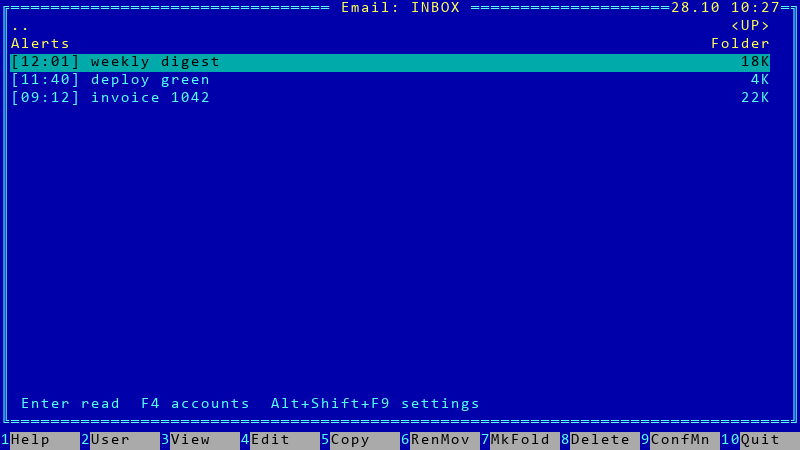
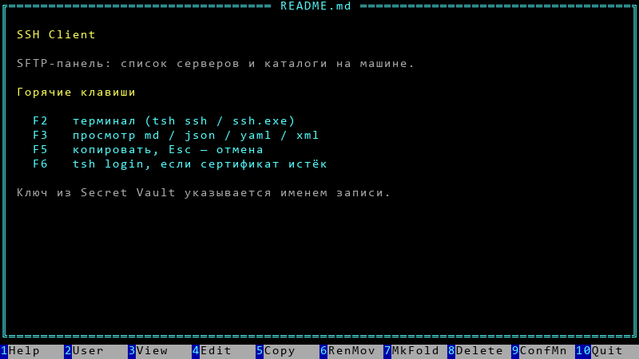

# User guide

[English](#en) · [Русский](#ru)

<a id="en"></a>

## English

Install plugins into `C:\Program Files\Far Manager\Plugins\<Name>`. Close FAR first, then run `install-plugin.bat <Name>` or `install-all.bat`.

Drive digits (`Alt+F1` / `Alt+F2`) are written by the plugins when the slot is empty: Email `5`, SSH `6`, Vault `7`, NoteKeeper `8`.

The frames below use the same layout as the live dialogs (width 63, labels on the left, edits from column 12, `{ Save } [ Cancel ]` at the bottom). They are diagrams, not screenshots from your machine.

Redraw the images:

```bat
python docs\tools\far_shots.py
```

### SSH Client

Drive `6` or `F11` → SSH, or the `ssh:` command.



On the list:

| Key | Action |
| --- | --- |
| Enter | SFTP |
| F2 / Shift+Enter | terminal: `tsh ssh` for Teleport, otherwise `ssh.exe` |
| F3 | host card |
| F4 | edit. Teleport is view-only — a `tsh ls` node or a saved entry with its address opens the card |
| F6 | `tsh login --mfa-mode=otp` in a new window |
| F7 / Shift+F4 | new server |
| F8 | delete a saved server; a `tsh ls` node itself is not removable |

Teleport hosts belong to `tsh`: a node is recognised by its `tsh ls` address, not by a port number. The plugin will not save a separate entry for one, `F4` opens the card instead of the editor, and `F8` on an entry saved by an older build removes only the local copy.

**Key** is a `~/.ssh` file name (`id_rsa`), a PEM path, or a **Secret Vault entry name**. For a non-Teleport host that identity is the only one used (`IdentitiesOnly`). The agent is required when the file is passphrase-protected. **Password** may also be a vault name. Empty fields look up a vault record by exact host.



SFTP is `ssh.exe`. With a key on the card: `-i` + `IdentitiesOnly=yes`, `~/.ssh/config` is not read (`-F NUL`). With no key — agent and `~/.ssh/config`, same as the console. Teleport: `ssh.exe` + `tsh proxy ssh` and the `~/.tsh` certificate. If `tsh login` expired — F6, not Enter.

When the server has no `Subsystem sftp`, the plugin stays on the same connection and switches to a shell transport: the listing comes from `find`, and where `find -printf` is missing from a loop over `stat`; files move through `cat`, and `mkdir`, `rm`, `rmdir` and `mv` do the rest. The format column then reads `SHELL` instead of `SFTP`. Bytes arrive exactly as over SFTP, but every operation costs its own channel, so a large tree copies slower, and on non-GNU servers sizes and dates may show up as zero.



In a directory: `F3` opens Markdown / JSON / YAML / XML in the local viewer, `F5` copies, `F6` renames, `F7` creates a folder, `Esc` returns to the server list.



The bar lives in a FAR window, not only on the taskbar button. `Esc` or **Cancel** aborts the transfer; a partial local file is deleted.

### Secret Vault

Drive `7` or `F11` → Secret Vault. `%APPDATA%\Far Manager\SecretVault\vault.bin` is encrypted with the current user's DPAPI.



`Passwords` and `Keys`. `F7` / `Shift+F4` — new entry (on the root the type follows the current row). In a folder: `F4` edit, `F5` / `Ctrl+C` secret to clipboard for 30 seconds, `F3` login or public key, `F8` delete.

Key from disk: stand on `id_ed25519` / `id_rsa` in the other panel and `F5` into `Keys`.



`Shift+Alt+F9` — sync with NoteKeeper (`Alt+F9` is still FAR's window size). HTTPS URLs only. The PAT is in DPAPI (`NoteKeeper\settings.ini`). A newer local revision is not overwritten. Export `Alt+F5`, import `Alt+F6` — AES-256-GCM with a password.

SSH reads the vault through `Plugin.SyncCall` (SSH Client only). If the plugin is silent — the same URL+PAT and REST `/api/v1/vault`.

### NoteKeeper

Drive `8`, `F11`, or `nk:`. Needs scopes `notes` and `todos` (plus `vault` for the vault).



`Notes` and `Todos`. `F3` view, `F4` edit Markdown in the FAR editor (writes back over REST), `F7` / `Shift+F4` create, `F8` delete, `Alt+F9` refresh. For a todo: `F5` / Space toggles; the card has repeat and Telegram / DingTalk channels. Copy from the other panel (`F5`) accepts only `.md` and `.txt`.

The PAT is DPAPI. `http://` only for localhost.

### Email Viewer

Drive `5`, `F11`, or `email:`. IMAP with SSL (port 993) or without (143).



`Alt+Shift+F9` — accounts: `F4` edit, `Shift+F4` add. Host, port, login, password, SSL. This plugin still stores passwords in plaintext `%APPDATA%\Far Manager\EmailViewer.ini`.

### Viewers

`F3` on a normal panel (and on SSH after the file is downloaded):

- Markdown: `.md`, `.markdown`, …
- Pretty: `.json`, `.yaml`, `.yml`, `.xml`
- HTML: `.html`, `.htm`, `.xhtml`



In the viewer: `F8` / `Shift+F8` theme (shared 16-color palette), `F7` find, `Esc` exit. Pretty also has `F2` — raw text.

Markdown renders HTML tags found in the document too, and adds selection and links: drag the mouse, double-click for a word, or hold `Shift` with the arrows / `Home` / `End`; `Ctrl+Ins`, `Shift+Ins` or `Ctrl+C` puts the selection in the clipboard. `Enter` follows a link on the current line — a `#heading` or another `.md` file — `Tab` picks between several, `Backspace` goes back.

### Install

Release build: [Releases](https://github.com/darvik80/far-manager-plugins/releases) → `install.bat`.

From source: `build.bat`, then with FAR closed `install-all.bat`.

---

<a id="ru"></a>

## Русский

[English](#en) · [Русский](#ru)

Плагины ставятся в `C:\Program Files\Far Manager\Plugins\<Name>`. Перед копированием DLL закрой FAR и запусти `install-plugin.bat <Name>` или `install-all.bat`.

Цифры дисков (`Alt+F1` / `Alt+F2`) плагины прописывают сами, если слот ещё пустой: Email `5`, SSH `6`, Vault `7`, NoteKeeper `8`.

Кадры ниже нарисованы в том же формате, что живые диалоги (ширина 63, подпись слева, поле с колонки 12, внизу `{ Сохранить } [ Отмена ]`). Это схемы, не скрины с твоей машины.

Перерисовать картинки:

```bat
python docs\tools\far_shots.py
```

### SSH Client

Диск `6` или `F11` → SSH, либо команда `ssh:`.


На списке:

| Клавиша | Действие |
| --- | --- |
| Enter | SFTP |
| F2 / Shift+Enter | терминал: `tsh ssh` для Teleport, иначе `ssh.exe` |
| F3 | карточка хоста |
| F4 | правка. Teleport только для просмотра: нода из `tsh ls` и сохранённая запись с её адресом открывают карточку |
| F6 | `tsh login --mfa-mode=otp` в отдельном окне |
| F7 / Shift+F4 | новый сервер |
| F8 | удалить сохранённый сервер; саму ноду из `tsh ls` удалить нельзя |

Teleport-хосты принадлежат `tsh`: нода узнаётся по адресу из `tsh ls`, а не по номеру порта. Отдельную запись на такой адрес плагин не сохранит, `F4` открывает карточку вместо редактора, а `F8` на записи из старой сборки удаляет только её локальную копию.

Поле **Ключ** — имя файла в `~/.ssh` (`id_rsa`), путь к PEM или **имя записи** Secret Vault. Для обычного (не Teleport) хоста логин идёт только этой личностью (`IdentitiesOnly`). Агент нужен, если файл закрыт паролем. **Пароль** тоже может быть именем из vault. Пустые поля ищут запись по точному хосту.


SFTP — `ssh.exe`. С ключом в карточке: `-i` + `IdentitiesOnly=yes`, конфиг `~/.ssh` не читается (`-F NUL`). Без ключа — агент и `~/.ssh/config`, как в консоли. Teleport: `ssh.exe` + `tsh proxy ssh` и сертификат `~/.tsh`. Если `tsh login` протух — F6, не Enter.

Если на сервере нет `Subsystem sftp`, плагин остаётся в том же соединении и переходит на shell-транспорт: список берётся из `find`, а где нет `find -printf` — циклом со `stat`; файлы ходят через `cat`, остальное делают `mkdir`, `rm`, `rmdir` и `mv`. В колонке формата вместо `SFTP` тогда читается `SHELL`. Побайтовая точность та же, что и в SFTP, но каждая операция стоит отдельного канала, поэтому большое дерево копируется медленнее, а на не-GNU серверах размеры и даты могут оказаться нулевыми.


В каталоге: `F3` открывает Markdown / JSON / YAML / XML локальным просмотрщиком, `F5` копирует, `F6` переименовывает, `F7` создаёт папку, `Esc` возвращает к списку серверов.


Полоса живёт в окне FAR, не только на кнопке панели задач. `Esc` или **Отмена** рвут передачу; недокачанный локальный файл удаляется.

### Secret Vault

Диск `7` или `F11` → Secret Vault. Файл `%APPDATA%\Far Manager\SecretVault\vault.bin` шифруется DPAPI текущей учётки.


`Пароли` и `Ключи`. `F7` / `Shift+F4` — новая запись (на корне тип зависит от строки под курсором). В каталоге: `F4` правка, `F5` / `Ctrl+C` секрет в буфер на 30 секунд, `F3` логин или публичный ключ, `F8` удалить.

Ключ с диска: встань на `id_ed25519` / `id_rsa` в другой панели и `F5` в `Ключи`.


`Shift+Alt+F9` — синк с NoteKeeper (`Alt+F9` по-прежнему размер окна FAR). URL только HTTPS. PAT лежит в DPAPI (`NoteKeeper\settings.ini`). Более новая локальная revision не затирается. Экспорт `Alt+F5`, импорт `Alt+F6` — AES-256-GCM с паролем.

SSH читает vault через `Plugin.SyncCall` (только SSH Client). Если плагин молчит — тот же URL+PAT и REST `/api/v1/vault`.

### NoteKeeper

Диск `8`, `F11`, либо `nk:`. Нужны scopes `notes` и `todos` (для vault ещё `vault`).


`Notes` и `Todos`. `F3` просмотр, `F4` правка Markdown в редакторе FAR (пишет обратно по REST), `F7` / `Shift+F4` создать, `F8` удалить, `Alt+F9` обновить. У todo: `F5` / Space — toggle, в карточке повтор и каналы Telegram / DingTalk. С другой панели `F5` принимает только `.md` и `.txt`.

PAT — DPAPI. `http://` только для localhost.

### Email Viewer

Диск `5`, `F11`, либо `email:`. IMAP с SSL (порт 993) или без (143).


`Alt+Shift+F9` — учётные записи: `F4` изменить, `Shift+F4` добавить. Host, порт, логин, пароль, SSL. Пароли этого плагина пока в открытом `%APPDATA%\Far Manager\EmailViewer.ini`.

### Просмотрщики

`F3` на обычной панели (и на SSH после скачивания файла):

- Markdown: `.md`, `.markdown`, …
- Pretty: `.json`, `.yaml`, `.yml`, `.xml`
- HTML: `.html`, `.htm`, `.xhtml`


В просмотре: `F8` / `Shift+F8` тема (общая палитра на 16 цветов), `F7` поиск, `Esc` выход. Pretty ещё `F2` — сырой текст.

Markdown рендерит найденные в документе HTML-теги, а ещё умеет выделение и ссылки: тянуть мышью, двойной клик — слово, либо `Shift` + стрелки / `Home` / `End`; `Ctrl+Ins`, `Shift+Ins` или `Ctrl+C` кладут выделенное в буфер. `Enter` переходит по ссылке на текущей строке — на заголовок `#…` или в другой `.md`, `Tab` выбирает из нескольких, `Backspace` — назад.

### Установка

Готовая сборка: [Releases](https://github.com/darvik80/far-manager-plugins/releases) → `install.bat`.

Из исходников: `build.bat`, затем с закрытым FAR `install-all.bat`.
